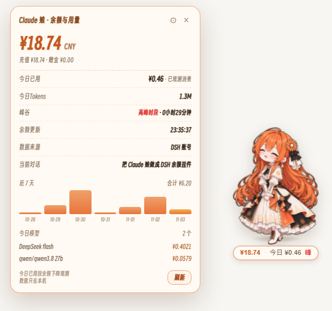
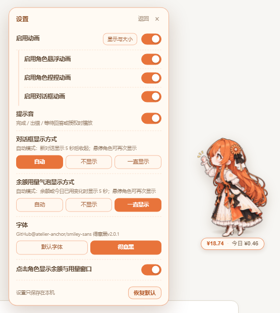

# DSH × Claude 娘桌宠（dsh-widget-pet）



> 预览图中的余额、对话与用量为模拟数据；挂件本体在 DSH 页面右下角。

把 [Claude 娘桌宠](https://github.com/BingXing-ai/claude-desk-pet) 的立绘、状态机和气泡，移植成
[DeepSeek Harness](https://github.com/deepseek-ai) Web 界面右下角的**余额小挂件**。

余额、消费记账与任务检测沿用 DSH 小鲸鱼挂件
[DeepSeek-Balance-Whale-Widget](https://github.com/MeteorNOX/DeepSeek-Balance-Whale-Widget) 的口径：
DeepSeek 余额、今日已用、每轮消耗、峰谷定价，以及「思考 / 读文件 / 跑命令 / 等你回答 / 等你授权 /
出错 / 被打断 / 石化」这些实时任务状态。

---

## 功能

### 余额与消费

- 💰 **余额**：优先使用 DSH 凭据里的 `DEEPSEEK_API_KEY`；没有 key 时自动退回 **DSH 账号登录态**
  （「设置 → 账号与余额」登录过即可，不需要另建 key）。60 秒自动刷新；点余额徽章打开面板，面板里可手动刷新。
- 📊 **今日已用**：按余额**下降**观测记账（`accounting.mjs`），充值 / 赠金只记为增加额，不会冲掉已有消费。
  首次观测当天从「此刻余额」起算，界面会标注「已观测消费」。
- 💬 **每轮消耗**：监听 DSH 本机会话事件，按模型真实 usage（input / cache / output）和峰谷单价换算金额；
  每轮结束在气泡里显示 `本轮 ¥0.0123 · 13.8k tokens`，并刷新今日已用。
- ⛰️ **峰谷时段**：工作日 9:00–12:00、14:00–18:00（北京时间）为高峰，周末 / 法定节假日全天谷价；
  面板里显示当前时段和距下次切换的时间。
- 📒 **近 7 天**：面板里按天柱状展示，今日按模型拆分；逐轮明细保留 90 天 / 2 万条，逐日汇总保留 365 天，
  超期数据归档到 `.dshcp-usage-archive.json`。

### 任务状态（桌宠表情）

直接监听 DSH 的 `session/event`，不需要读 Claude Code 的 hooks：

| DSH 事件 | 桌宠状态 | 气泡 |
|---|---|---|
| `turn/start` | 闭眼思考 | 思考中… |
| `tool/call`：read / grep / glob / web / skill | 捧书 | 在读 xxx / 在找东西… / 在上网查… |
| `tool/call`：write / edit / pwsh / bash | 敲键盘 | 在改 xxx / 在跑命令… |
| `tool/call`：subagent / workflow | 敲键盘 | 派小助手干活中 |
| `tool/result` 出错 | 慌张冒汗 | 出错了… |
| 连续 3 次工具出错 | 石化 🗿 | 石化了… |
| `approval/asked` | 敲门 | 等你授权…（徽章闪橙点） |
| `ask_user_question` | 敲门 | 等你回答…（徽章闪橙点） |
| `turn/end` completed | 开心 | 轮到你啦！ |
| completed 且超过 3 分钟 | 撒花 | 搞定啦！轮到你～ |
| `turn/end` aborted | 心虚 | 被打断了… |
| `turn/end` error / refusal | 慌张 | 出错了，来看看？ |
| 等待超过 10 分钟 | 发呆 | 在发呆～ zZ |

### 交互

- **左键点角色 / 余额徽章**：打开「余额与用量」面板（余额、充值 / 赠金、今日已用、最近一轮、峰谷、近 7 天、今日模型）。
- **拖动**：按住角色拖到任意位置；位置存在浏览器 `localStorage`。
- **右键**：菜单里切换大小（小 / 中 / 大）、打开设置、刷新余额、隐藏桌宠。
- **提示音**：一轮完成 / 出错 / 等待回答或授权时播放 `done.wav` / `error.wav`，可在设置里总开关。
- **显示设置**（「余额与用量」面板右上角 ⚙，或右键菜单「设置」）：
  - 启用动画：总开关，关闭后角色与对话框动画全部停止；
  - 启用角色悬浮动画：角色上下浮动、换状态时的小跳；
  - 启用角色捏捏动画：点击角色时压缩回弹，像被捏了一下；
  - 启用对话框动画：气泡出现 / 收起的过渡与「思考中」的点点动画；
  - 显示与大小：点开后弹出右键菜单，可调大小、隐藏桌宠等；
  - 提示音：完成 / 出错 / 等待回答或授权时是否播放；
  - 对话框显示方式：自动（新对话显示 5 秒后收起）/ 不显示 / 一直显示，默认自动；
  - 余额用量气泡显示方式：自动（余额或今日已用变化时显示 5 秒）/ 不显示 / 一直显示；
  - 字体：默认字体 / 得意黑（内置 Smiley Sans v2.0.1，SIL OFL-1.1；默认得意黑）；
  - 点击角色显示余额与用量窗口：关闭后点角色不再打开面板，仍可点余额徽章或右键菜单打开。
- 隐藏后右下角留一个圆形头像按钮，点一下召回。



---

## 安装

> 插件目录必须放在**以后不会移动或删除**的位置；用 `link:` 安装后移动目录需要重新安装。
>
> 从旧包名 `dsh-claude-pet` 升级时，请先移除旧包再安装 `dsh-widget-pet`，否则两个挂件会同时出现。
> 账本文件（`.dshcp-*`）与浏览器设置键（`dshcp-*`）没有改名，已有消费记录、位置和开关会继续沿用。

### 官方桌面端（Electron，当前 profile 为 `desktop`）

桌面端 profile 由应用自身管理，`dsh plugin --profile desktop …` 会被拒绝。推荐在桌面端会话里让宿主安装：

> 请使用当前桌面端内置的 `plugin_manager` 安装本地插件 **dsh-widget-pet**。
> 安装规格：`link:E:\UsersDir\Documents\deepseek-harness\default-workspace\DSH-DesktopPet\claude-pet-widget`
> 先核对当前 profile 与是否已有同名插件；完成后告诉我安装结果以及是否需要重启。

安装后**完全退出客户端（含托盘）再重开**，右下角就会出现 Claude 娘。

如果当前宿主没有可用的 `plugin_manager`，再用手动方式（先备份 `package.json`）：

1. 打开 `%USERPROFILE%\.dsh\profiles\desktop\package.json`；
2. 在 `dependencies` 里加
   `"dsh-widget-pet": "link:E:\\UsersDir\\Documents\\deepseek-harness\\default-workspace\\DSH-DesktopPet\\claude-pet-widget"`；
3. 在 `dsh.profile.bundles` 里加一项 `"dsh-widget-pet"`；
4. 在 `%USERPROFILE%\.dsh\profiles\desktop\node_modules` 下建目录联接：
   ```powershell
   New-Item -ItemType Junction `
     -Path "$env:USERPROFILE\.dsh\profiles\desktop\node_modules\dsh-widget-pet" `
     -Target "E:\UsersDir\Documents\deepseek-harness\default-workspace\DSH-DesktopPet\claude-pet-widget"
   ```
5. 完全退出并重开桌面端。

### Web（`dsh web`）

```powershell
dsh plugin --profile web add link:E:\UsersDir\Documents\deepseek-harness\default-workspace\DSH-DesktopPet\claude-pet-widget
```

装完重启 `dsh web`，浏览器按 `Ctrl+F5`。也可以用 `dsh plugin --profile web add file:<目录>` 做拷贝安装
（之后源目录改动不会同步）。

### 安装后自检

- 浏览器访问 `http://127.0.0.1:<端口>/dsh-widget-pet/state.json`，应返回 `{"ok":true,...}`；
- `%USERPROFILE%\.dsh\.dshcp-usage.json` 出现，且余额刷新后 `accounting.books` 里有当天记录；
- 右下角出现角色与 `¥余额 · 今日 ¥x` 徽章。

> 路由只接受**本机回环**请求，并校验 `Origin` / `Sec-Fetch-Site`；局域网或反代访问会被 403。

---

## 数据与隐私

运行数据都在 `$DSH_HOME`（默认 `%USERPROFILE%\.dsh`）：

| 文件 | 内容 |
|---|---|
| `.dshcp-usage.json` | 余额观测账本 + 逐轮用量事件 + 按日汇总 |
| `.dshcp-usage-archive.json` | 超期归档（明细 90 天 / 2 万条，汇总 365 天） |
| `.dshcp-turn.json` | 最近一轮的持久化序号（避免重启后前端重播提示音） |

- API key 只通过 DSH 的凭据服务读取，**不会下发给浏览器，也不会写进账本**；
- 前端只调用 `/dsh-widget-pet/*` 的只读接口，设置存在浏览器 `localStorage`（键 `dshcp-*`）；
- 不联网查询除 DeepSeek 官方余额接口以外的任何地址（账号路走 DSH 自身服务）。

---

## 常见问题

**余额显示「余额 —」**
先在「设置 → 账号与余额」登录 DeepSeek 账号，或在凭据里配置 `DEEPSEEK_API_KEY`。
点开面板会显示两条路各自的失败原因（API key 路 / 账号登录路）。

**今日已用是 0**
余额观测需要页面开着且能取到余额。当天第一次成功取数时从「此刻余额」起算，所以刚装上时今日已用为 0；
之后余额下降才会累计。跨零点或长时间没开页面会标记为部分数据。

**每轮消耗和今日已用对不上**
两者口径不同：每轮消耗是用 token 与价目表**估算**；今日已用是**余额下降观测**（DeepSeek 账户口径）。
面板里分别标注，不会混成一个数。

**桌面端右下角什么都没有**
1. 确认插件已进入 `profiles/desktop/package.json` 的 `dsh.profile.bundles`；
2. 桌面端的注入表在**宿主启动时一次性收集**，装完必须完全退出重开，不能只刷新页面；
3. 看宿主日志里有没有 `dsh-widget-pet` 的加载错误。

**改了 `assets/claude-pet.js` 不生效**
宿主按 mtime 热读取脚本，浏览器 `Ctrl+F5` 即可；改 `lib/index.js` 需要重载插件或重启宿主。

---

## 目录结构

```text
dsh-widget-pet/
├── package.json
├── cordis.patch.yml          # bundle 挂载声明
├── icon.png                  # 插件列表图标（256×256）
├── lib/
│   ├── index.js              # 宿主：余额 / 记账 / 任务状态机 / 只读路由 / 注入
│   └── accounting.mjs        # 记账内核（定点金额 + 余额观测账本，来自小鲸鱼挂件，MIT）
├── assets/
│   ├── claude-pet.js         # 前端挂件：立绘动画、气泡、面板、菜单、音效
│   ├── sprites/*.png         # 10 张立绘（来自 claude-desk-pet）
│   ├── sounds/*.wav          # done / error（来自 claude-desk-pet）
│   └── fonts/                # 得意黑 Smiley Sans v2.0.1（OFL-1.1）
├── docs/*.png                # README 展示图（余额面板 / 设置页）
└── dev/                      # 本机测试脚本（npm 包不包含，源码目录 / 压缩包保留）
    ├── test-host.mjs         # mock 宿主：任务状态 / 记账 / 路由 / 安全
    └── preview-server.mjs    # 模拟 DSH 页面，给无头浏览器截图用
```

### 开发与测试

```powershell
# 语法检查
node --check lib/index.js
node --check assets/claude-pet.js

# mock 宿主集成测试（不碰真实 ~/.dsh）
node dev/test-host.mjs

# 预览页面（默认 http://127.0.0.1:51977/）
node dev/preview-server.mjs 51977
```

`dev/preview-server.mjs` 支持 `?scenario=waiting|reading|thinking|approval|error|celebrate|idle|nobalance`
和 `?panel=1`（自动打开余额面板），方便看排版。

### 换立绘 / 改台词

- 立绘：替换 `assets/sprites/` 下同名 PNG（透明背景，建议 292×400），文件名保持不变；
- 字体：可替换 `assets/fonts/SmileySans-Oblique.ttf`；字体设置里的「得意黑」始终读取这个文件；
- 台词：改 `lib/index.js` 里的 `setPet(...)` 文案与 `describeTool()`；
- 提示音：替换 `assets/sounds/done.wav` / `error.wav`。

---

## 与两个原项目的关系

- **立绘、状态机、气泡与提示音**来自 [claude-desk-pet](https://github.com/BingXing-ai/claude-desk-pet)
  （Python 桌面悬浮窗 + Claude Code hook）。本移植把 Python 悬浮窗换成 DSH 页面内挂件，
  把 Claude Code hook 换成 DSH 的 `session/event`。
- **余额、记账、峰谷定价与「每轮消耗」口径**来自
  [DeepSeek-Balance-Whale-Widget](https://github.com/MeteorNOX/DeepSeek-Balance-Whale-Widget)
  0.4.2 的 `accounting.mjs` 与宿主实现（MIT），没有使用小鲸鱼的美术素材。
- **得意黑（Smiley Sans v2.0.1）** 来自
  [atelier-anchor/smiley-sans](https://github.com/atelier-anchor/smiley-sans)，按 **SIL Open Font License 1.1** 随插件分发；
  完整许可与版权声明见 `assets/fonts/README.md` 及上游仓库。
- 这是个人粉丝作品，与 Anthropic、DeepSeek 官方无关。

## 许可

代码 MIT，详见 [LICENSE](LICENSE)；素材来源与许可范围见 [PROVENANCE.md](PROVENANCE.md)。
